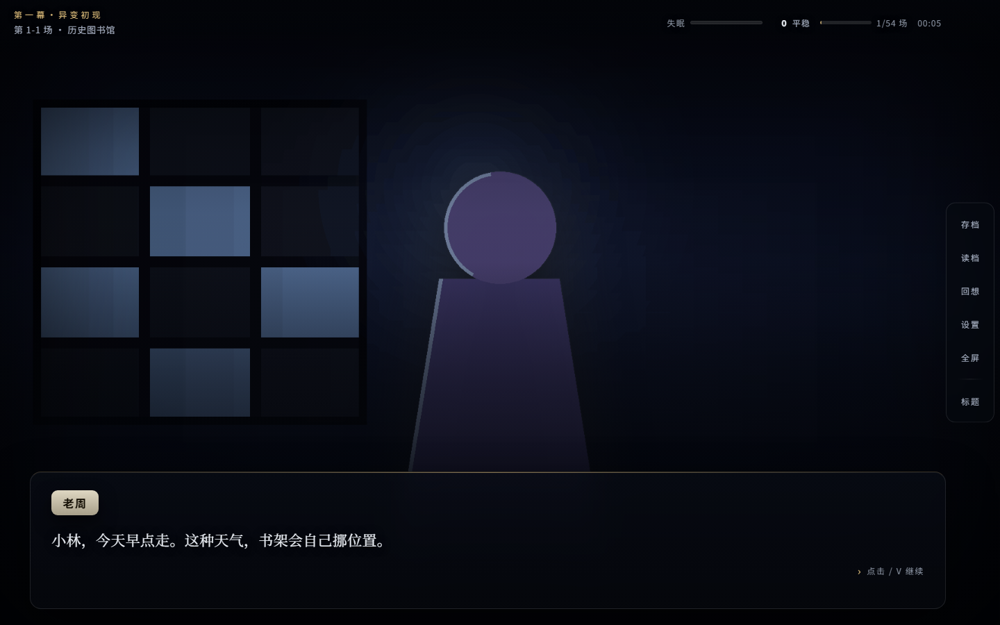
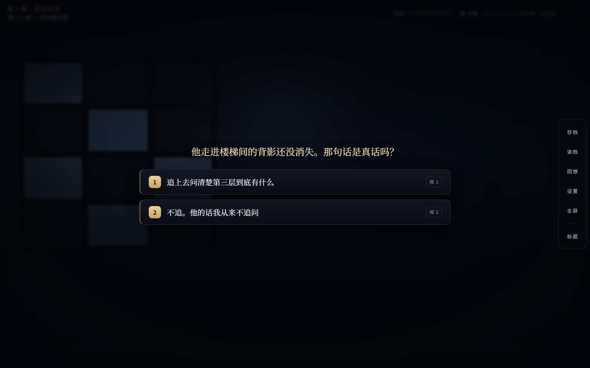
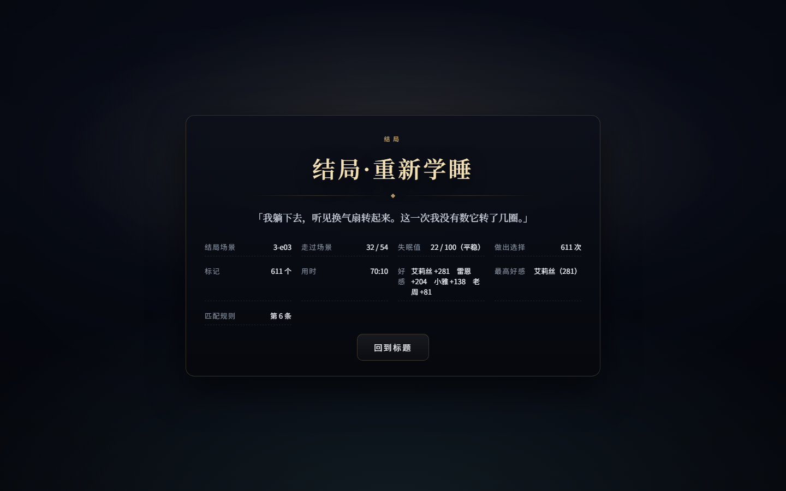
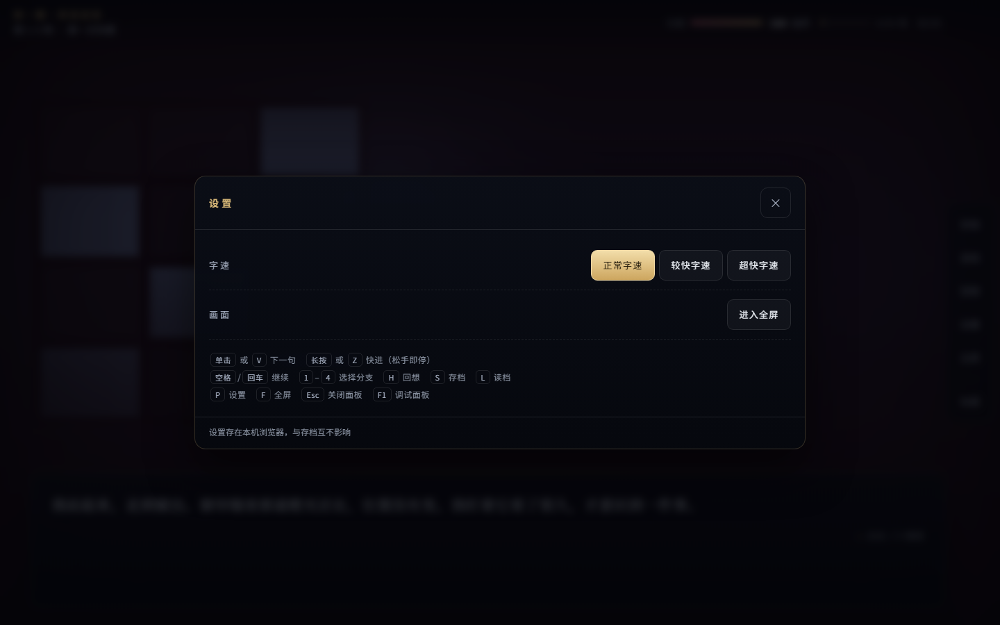
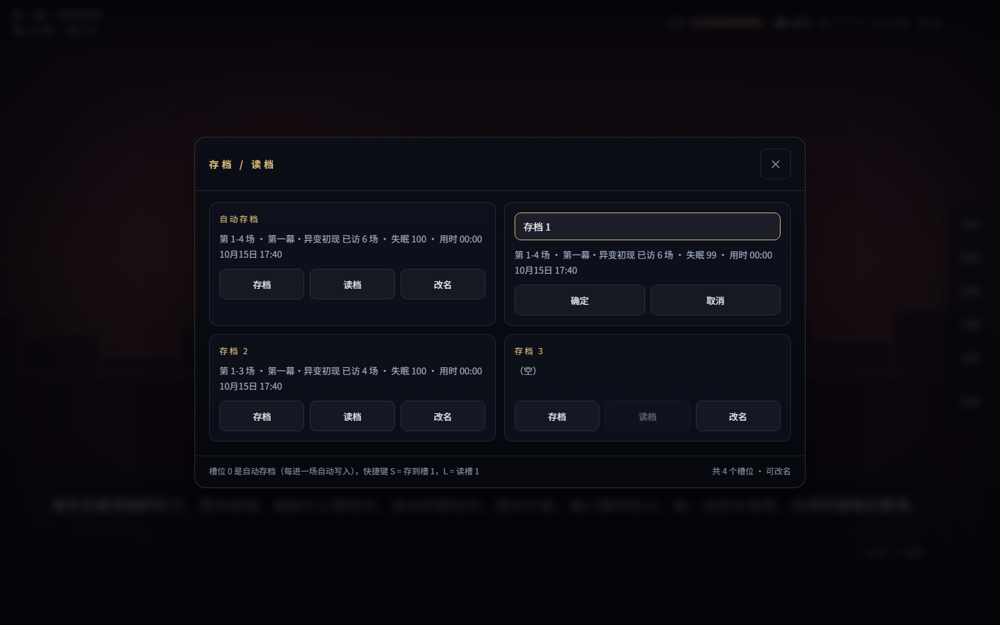
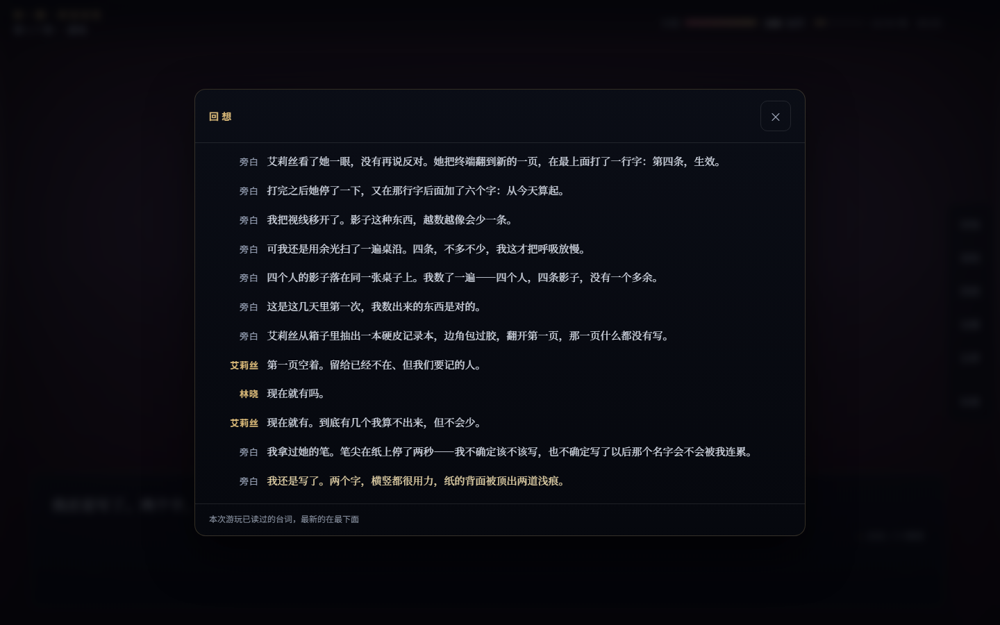
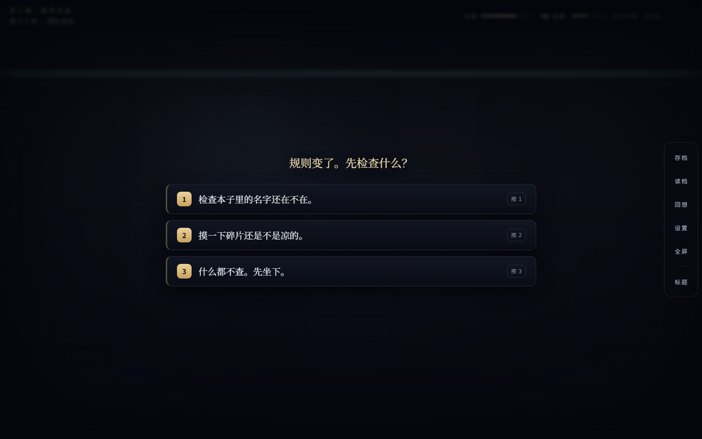

# 《时光之痕》Unity项目

## 项目概述

《时光之痕》是一款科幻奇幻视觉小说游戏，结合了时间线穿梭、失眠状态系统、记忆碎片收集等创新机制。

## 快速试玩（免安装）

**双击即玩**：下载单文件 Windows 试玩包（约 91 MB，内嵌全部 54 场剧本 · 约 17 万字 · 86 张美术，无需 Unity / Node）：

- [时光之痕-试玩.exe（GitHub Release v1.0.0 下载）](https://github.com/xiwu0726/chengguang_games/releases/download/v1.0.0/TimeOfFragments-demo-v1.0.0.exe)
- Release 页：https://github.com/xiwu0726/chengguang_games/releases/tag/v1.0.0
- 首次运行若出现 SmartScreen 蓝框，点「更多信息 → 仍要运行」即可（未做代码签名）。
- 轻量网页版：打开 [`preview/index.html`](preview/index.html) 同样可玩（1.05 MB，单文件；美术走相对路径）。

## 界面预览

播放器版式参照橙光（66rpg）交互习惯重做，配色保留本作自己的深夜蓝 + 古铜金：**背景铺满全屏无黑边**、**底部对话条**、**右缘竖排菜单栏**（存档 / 读档 / 回想 / 设置 / 全屏 / 标题），并支持三档字速与存档改名。

| 标题页 | 对话 | 选择 | 结局结算 |
| --- | --- | --- | --- |
|  |  |  |  |
| **设置（字速 / 全屏 / 快捷键）** | **存档改名** | 回想 | 第三幕深夜 |
|  |  |  |  |

其余截图（CG 演出、存档列表）见 [`docs/ui/`](docs/ui/)。

## 操作方式

| 操作 | 鼠标 | 键盘 |
| --- | --- | --- |
| 下一句 | 单击画面 | `V` / 空格 / 回车 |
| 快进 | 长按 0.32 秒（松手即停） | 按住 `Z` |
| 选分支 | 点选项卡 | `1`–`4` |
| 回想 / 存档 / 读档 | 右缘菜单 | `H` / `S` / `L` |
| 设置（字速三档）/ 全屏 | 右缘菜单 | `P` / `F` |
| 关闭面板 / 调试面板 | — | `Esc` / `F1` |

存档槽 0 是自动存档（每进一场自动写入）；槽 1–3 可在存档面板里点「改名」自定义名称。字速、存档名等设置存在浏览器本机，与剧本存档互不影响。

## 项目状态

✅ **剧本已完成**：54 场 / 约 170,648 字（目标 10 万字的 170.6%），20 条结局规则全部可达
✅ **试玩 exe 已出包**：`node story/tools/build-exe.js` 一键重建，产物 `dist/时光之痕-试玩.exe`（约 91 MB，内嵌页面 2.91 MB）
✅ **结局路由已实现**：`Assets/Scripts/Story/EndingResolver.cs` 读取 `StoryConfig/endings.json`，与网页播放器同一套语义；测试见 `tools/ending-resolver-tests/`（C# 91 例全过，与 JS 交叉比对 61 例全一致）
✅ **Unity 脚本已离线验证 0 编译错误**：61 个历史脚手架文件用 `#if CG_LEGACY` 屏蔽（运行时链路不引用它们），详见说明文档
✅ **美术已重生成**：`Assets/Resources/Art` 104 张占位氛围图（不再烙资源名）；正式出图流水线见 `art/manifest.json` + `story/tools/gen-art.js`
✅ **代码已完成**：45个C#脚本文件，约11300行代码
✅ **文档已完成**：32个详细设计文档
⏳ **Unity 原生包**：编辑器已装（2021.3.45f2），**只差本人登录 Unity Hub 领取免费 Personal 许可证**。激活后一条命令出包：`powershell -File scripts\build-unity.ps1`（见 [Unity 激活与出包说明.md](<Unity 激活与出包说明.md>)）

## 核心系统

1. **对话系统**：支持多分支剧情、角色立绘、选择对话框
2. **失眠状态系统**：4级失眠状态，影响视觉效果和对话方式
3. **时间线切换系统**：4个时间线（主时间线、过去、未来、梦境）
4. **记忆碎片收集系统**：3种记忆类型，收集记忆解锁剧情
5. **多结局系统**：6种结局类型
6. **音频系统**：BGM、音效、语音配音管理
7. **Rogue Like元素**：随机事件、随机奖励、多周目重玩性

## 快速开始

**只想试玩**：下载上面的 Release exe，或双击 `preview/index.html`（轻量网页版，需保留仓库目录结构）。

**要出 Unity 原生包**：先按 [Unity 激活与出包说明.md](<Unity 激活与出包说明.md>) 的第一步激活许可证（只有本人能做），然后：

```powershell
powershell -NoProfile -ExecutionPolicy Bypass -File scripts\build-unity.ps1        # 出包到 Build\Windows\时光之痕.exe
powershell -NoProfile -ExecutionPolicy Bypass -File scripts\build-unity.ps1 -Run   # 出完直接跑
```

也可以在编辑器里用菜单 **时光之痕 → 构建 Windows 可执行文件**；**时光之痕 → 在编辑器里试玩（Play）** 任意场景直接开局（工程是零场景设计，UI 全部由代码在运行时创建）。

**改剧本后重建网页版与 exe**：

```powershell
node story/tools/build-preview.js --standalone   # 自包含单文件 preview/时光之痕-试玩.html
node story/tools/build-preview.js                # 轻量版 preview/index.html
node story/tools/smoke-preview.js                # 冒烟：跑通全流程到结局
node story/tools/build-exe.js                    # 重打 dist/时光之痕-试玩.exe（自带自检）
```

## 项目结构

```
TimeOfFragments/
├── Assets/
│   ├── Scripts/
│   │   ├── Dialogue/          # 对话系统
│   │   ├── Insomnia/          # 失眠状态系统
│   │   ├── TimeLine/          # 时间线系统
│   │   ├── Ending/            # 多结局系统
│   │   ├── Audio/             # 音频系统
│   │   ├── RogueLike/         # Rogue Like系统
│   │   └── Test/              # 测试系统
│   └── Scenes/
│       └── MainScene.unity    # 主场景
├── ProjectSettings/
└── README.md
```

## 系统架构

### 对话系统
- `DialogueManager`：统一管理对话
- `DialogueSystem`：对话文本显示
- `CharacterSpriteSystem`：角色立绘显示
- `ChoiceSystem`：选择对话框
- `KeyChoiceManager`：关键选择点
- `BranchingStorySystem`：分支剧情

### 失眠状态系统
- `InsomniaController`：主控制器
- `InsomniaStateManager`：状态管理
- `SpaceDistortionEffect`：空间扭曲效果
- `TimeLineVisualizer`：时间线可视化
- `InsomniaAudioManager`：失眠音效
- `StreamOfConsciousnessDialogue`：意识流对话

### 时间线系统
- `TimeLineController`：主控制器
- `TimeLineManager`：时间线管理
- `TimeLineSwitcher`：切换机制
- `TimeLineTransitionEffect`：切换效果

### 多结局系统
- `EndingController`：主控制器
- `EndingManager`：结局管理
- `EndingTrigger`：结局触发

## 开发计划

1. ✅ 完成核心设计文档
2. ✅ 实现所有核心系统
3. ⏳ 创建Unity项目
4. ⏳ 制作美术资源
5. ⏳ 制作音频资源
6. ⏳ 编写完整剧情
7. ⏳ 测试和优化
8. ⏳ 发布

## 技术栈

- **引擎**：Unity 3D
- **语言**：C# (C# 8.0+)
- **平台**：PC、移动端（iOS、Android）

## 许可证

本项目仅供学习和研究使用。

## 联系方式

如有问题或建议，请通过项目仓库提交Issue。

---

**最后更新**：2025年6月
**项目状态**：开发中
